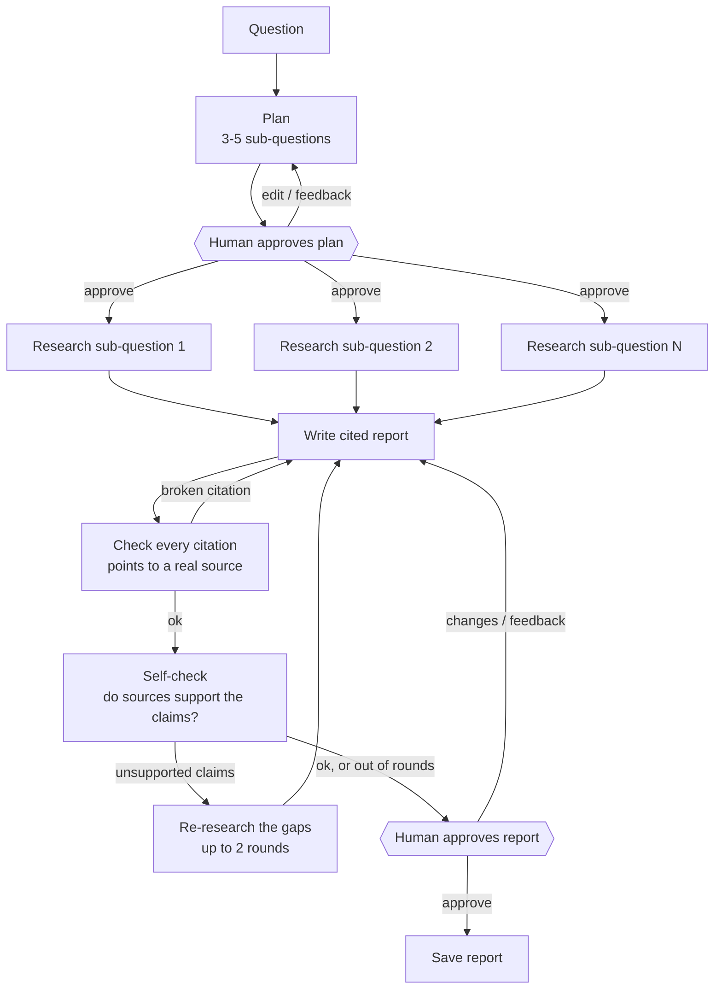
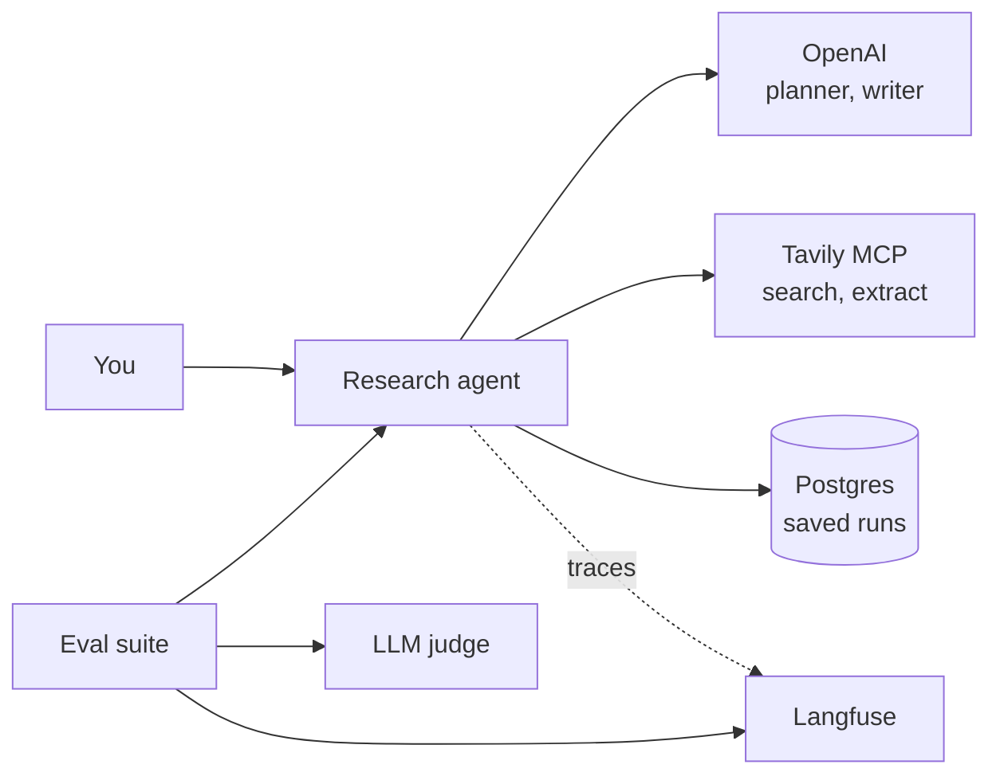

# research-agent

A research agent that turns a question into a cited report. It breaks the question into sub-questions, researches them in parallel on the live web, writes a report where every claim cites a source, and checks that the sources actually support those claims. A human approves the plan before research starts and the report before it is saved.

Runs are saved to Postgres as they go, so a run can wait for approval for as long as needed, be resumed later by its ID, and pick up where it left off after a crash. Every run is traced in Langfuse, and an eval suite scores report quality on a fixed set of questions.

## How it works



1. **Plan.** The question is split into 3–5 sub-questions. You can edit them, or send feedback and get a new plan.
2. **Research.** Each sub-question is researched in parallel through [Tavily](https://tavily.com)'s web search and page extraction.
3. **Write.** The report cites sources by ID, such as `[S3]`.
4. **Check.** Code confirms every citation points to a source that was actually fetched. An LLM then checks whether each source supports the claim it is cited for. Unsupported claims go back for targeted research, up to two rounds. Anything still unresolved is flagged for the reviewer rather than hidden.
5. **Review.** You approve the report or ask for changes. Approved reports are saved as Markdown with their sources, any unresolved gaps, and run details.

### System



## Setup

You'll need Python 3.13+, [uv](https://docs.astral.sh/uv/), Docker, and API keys for OpenAI and Tavily. Langfuse keys are optional for running the agent and required for evals.

```bash
uv sync
cp .env.example .env   # then fill in keys and model names
docker compose up -d postgres
uv run pytest
```

In `.env`, set a cheaper `PLANNER_MODEL` for planning and research, a stronger `WRITER_MODEL` for the report, and a `JUDGE_MODEL` that differs from the writer, so the judge doesn't grade its own writing.

## Usage

A command-line interface and an HTTP API are in progress. For now, the agent is driven from Python.

A run goes like this:

1. **Start** a run with your question and a `thread_id`. The agent plans, then pauses and shows you the proposed sub-questions.
2. **Review the plan.** Approve it, edit the sub-questions, or send feedback for a new plan. Once approved, the agent researches, writes, and checks the report, then pauses again with the draft, its sources, and any claims it couldn't support.
3. **Review the report.** Approve it, or send feedback and the agent revises the draft.

The approved report is written to `results/<thread_id>.md`. A run can wait at an approval for as long as needed. If the process stops at any point, resume the same `thread_id` and it continues from the last saved step.

For batch runs or testing, set `auto_approve` when starting a run to skip both approvals.

## Evaluation

The agent is scored in Langfuse on a fixed set of 10 research questions. No reference answers are needed: each report is checked against the sources its own run fetched.

| Score | What it measures |
|---|---|
| `citation_support` | Share of cited claims an LLM judge finds supported by the cited source. The judge is calibrated against hand labels (90–93% agreement) before it is trusted. |
| `citations_valid` | Every citation points to a real fetched source (code check). |
| `unresolved_gaps` | Claims the agent itself still flagged as unsupported at the end. |

```bash
uv run python -m evals.dataset                 # upload the question set to Langfuse
uv run python -m evals.run --name my-change    # run the agent on every question and score it
uv run python -m evals.compare <run-a-id> <run-b-id>
```

Scores are only comparable between runs scored by the same judge version.

### Results

Three versions of the agent, each run on all 10 questions and scored by the same judge (v3 twice to check the result is stable). v2 fixed prompt problems in the self-check and writer. v3 told the writer to stick to what its sources say instead of adding its own conclusions, and moved to a stronger writer model.

| Per run of 10 questions | v1 | v2 | v3 run 1 | v3 run 2 |
|---|---|---|---|---|
| `citation_support` (mean per report) | 66.8% | 69.6% | **95.8%** | **97.1%** |
| Unsupported claims | 31 of 93 (33%) | 36 of 118 (31%) | **11 of 265 (4.2%)** | **7 of 243 (2.9%)** |
| Cited claims per report | 9.3 | 11.8 | 26.5 | 24.3 |
| Words per report | 527 | 503 | 768 | 738 |
| `citations_valid` | 1.00 | 1.00 | 1.00 | 1.00 |
| Agent cost per run (excluding the judge) | $0.096 | $0.077 | $0.112 | $0.109 |

Unsupported claims fell from about a third of cited claims to 3–4%, while reports got longer and made more than twice as many claims. Every question improved in both v3 runs.

## Project layout

```
src/research_agent/   the agent: graph, nodes, Tavily tools, tracing
evals/                eval dataset, code checks, LLM judge, calibration, experiment scripts
tests/                unit and graph tests
```
